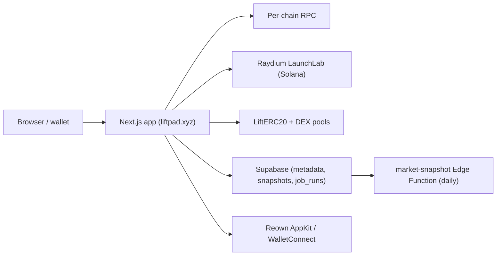

# liftpad

Launch and trade community tokens across seven networks — Solana, Base, BNB Chain, HyperEVM, Arbitrum, Robinhood Chain, and Arc.

The live site is [liftpad.xyz](https://liftpad.xyz) (`src/app/layout.tsx`). npm package name in this repo is `still-launchpad`.

## What it does

liftpad is a Next.js launchpad: explore tokens, create a launch, open a token page (with a daily chart and market snapshot), and view a portfolio of your launches. Creators fund liquidity and sign from their own wallet. Solana launches go through Raydium LaunchLab with a platform configuration; EVM tokens can be deployed from the included `LiftERC20` contract. Market snapshots and job runs live in Supabase.

The protocol token **LIFT** (fees split treasury / creator / burn, no transfer tax) and the on-page protocol figures in `src/lib/protocol.ts` are marked `illustrative: true` — those generated totals are not live telemetry.

## Why it exists

To offer an independent, minimal launch-and-trade experience on multiple chains (including Stock Token pairs on Robinhood Chain), without depending on another launchpad's brand. `HANDOFF.md` is the project's canonical plan and journal (Romanian).

## Features

- **Explore, Create, Token, Portfolio** screens (`src/app/`, `src/components/`), including a homepage movers strip and a token daily chart.
- Seven validated networks, defined in `src/lib/chains.ts`: Solana, Base (8453), BNB Chain (56), HyperEVM (999), Arbitrum (42161), Robinhood Chain (4663), Arc (5042).
- Solana launch path via Raydium LaunchLab (`src/lib/server/solana-launch.ts`, `LAUNCHLAB_PLATFORM_ID`).
- EVM token contract `contracts/LiftERC20.sol` and launch helpers under `src/lib/server/evm-launch.ts`.
- Wallet connect: Reown AppKit (WalletConnect) is the **primary** mobile path so the session stays in the browser tab; native Phantom `ul/v1/connect` is a secondary fallback only. Do not use Phantom `ul/browse`.
- Launch session progress is saved so a creator can resume without minting a second token by accident (`src/lib/create-session.ts`).
- Daily market snapshots (Supabase Edge Function `supabase/functions/market-snapshot`) power the token-page daily chart, a network-rank badge, and the homepage movers strip, and also keep a free-tier Supabase project from pausing. See that function's own README for deploy and cron notes.
- API routes for launch, liquidity, buy, trade quotes, market, movers, snapshots, charts, share images, eligibility, registry, status, and chain transactions.
- Docker Compose stack: Next.js app + Caddy TLS reverse proxy for `liftpad.xyz`.
- Unit tests under `tests/` (`npm test`).

Stock Token pairs are recognized in `src/lib/protocol.ts` (`isStockPair`). Serving stock-token eligibility is gated in server config on variables that are **not** listed in `.env.example` (`STOCK_TOKENS_ENABLED` and `ELIGIBILITY_VERIFIER_URL` in `src/lib/server/config.ts`). Treat that path as configured only when you set those yourself.

## Architecture and stack

Next.js (App Router) + TypeScript, ethers / viem / Solana web3.js, Raydium SDK, Reown AppKit, Supabase, Caddy, Docker. Node is built on `node:22` in the Dockerfile.



## Project structure

```
src/app/                 # Pages: /, /create, /portfolio, /status
src/app/api/             # Launch, market, quotes, snapshots, status, …
src/components/          # Explore, create, token detail, portfolio, charts
src/lib/                 # Chains, wallet, protocol, server launch + market
contracts/LiftERC20.sol
supabase/migrations/     # 001_initial, 002_fee_ledger_airdrop, 003_market_snapshots
supabase/functions/market-snapshot/
data/                    # Platform / quote-asset JSON
deploy/                  # Deploy scripts and Oracle notes
docker-compose.yml
Caddyfile
Dockerfile
tests/
public/tokens/ember.webp
social/liftpad-x-post.md
HANDOFF.md
```

## Installation

```sh
git clone https://github.com/mar1uz/liftpad.git
cd liftpad
cp .env.example .env        # then fill in values — do not commit secrets
npm install
npm run dev                 # next dev on 127.0.0.1
```

```sh
npm run typecheck
npm test                    # tsx --test tests/*.test.ts
npm run check               # typecheck + test
npm run build
npm start                   # next start on 127.0.0.1
```

With Docker (app + Caddy):

```sh
docker compose up --build
```

The compose health check calls `http://127.0.0.1:3000/api/status`.

## Configuration

Names from `.env.example` only (never commit real values):

| Variable | Purpose |
| --- | --- |
| `NODE_ENV` | Node environment. |
| `RPC_SOLANA` | Solana RPC URL. |
| `RPC_BASE` | Base RPC URL. |
| `RPC_BSC` | BNB Chain RPC URL. |
| `RPC_HYPEREVM` | HyperEVM RPC URL. |
| `RPC_ARBITRUM` | Arbitrum RPC URL. |
| `RPC_ROBINHOOD` | Robinhood Chain RPC URL. |
| `RPC_ARC` | Arc RPC URL. |
| `LAUNCHLAB_PLATFORM_ID` | Raydium LaunchLab platform id. |
| `NEXT_PUBLIC_WALLETCONNECT_PROJECT_ID` | Reown / WalletConnect project id (inlined at **build** time; create one at [dashboard.reown.com](https://dashboard.reown.com)). |
| `SUPABASE_URL` | Supabase project URL (server-side). |
| `SUPABASE_SERVICE_ROLE_KEY` | Supabase service role key. **Server-side only** — never expose it to the browser. |

The Edge Function README also mentions `MARKET_SNAPSHOT_APP_ORIGIN` (optional; defaults to `https://liftpad.xyz`) as a dashboard secret, not as a repo `.env.example` entry.

## Usage

1. Set RPC URLs and, for production, Supabase and the WalletConnect project id.
2. Run `npm run dev` and open the app on `127.0.0.1`.
3. Connect a wallet, use Explore to browse tokens, Create to start a launch, and Portfolio to see launches saved on the device / connected wallet.
4. `/status` and `GET /api/status` report service status.

Production is intended to be served at `https://liftpad.xyz` behind Caddy.

## Assets

- `public/tokens/ember.webp` — token image used by the app.
- `src/app/icon.svg` — app icon.

## Roadmap

From `HANDOFF.md` (canonical plan; items below are **planned** unless you have already wired them in a later change):

- Broader reuse of managed indexing, official Stock Token registries, and IPFS pinning, as described in the plan — only treat them as done if the corresponding code path is enabled in your deployment.
- Monthly creator airdrop of 25% of platform fees on the 1st for the prior month (`PROTOCOL.airdropCadence` in `src/lib/protocol.ts`).
- Watchlists, richer social cards, and admin tools called out in the plan.

See also `supabase/functions/market-snapshot/README.md` for scheduling the daily snapshot job.

## License

This project is licensed under the [MIT License](LICENSE).
